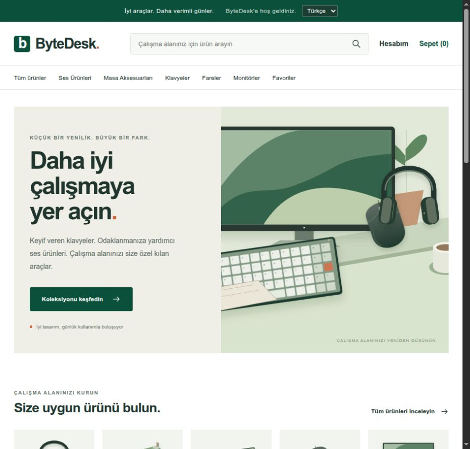
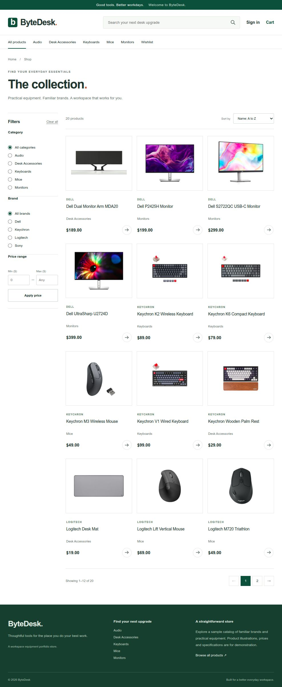

# ByteDesk

An e-commerce portfolio project for computer and workspace equipment. It includes a React storefront, a FastAPI API, and Django Admin connected to one PostgreSQL database. Checkout creates demo orders without taking payment.

## Screenshots

**Storefront — Turkish**



<details>
<summary>Product catalog</summary>



</details>

## Stack and architecture

React 19, Vite, JavaScript, React Router and plain CSS on the frontend. FastAPI, Pydantic, SQLAlchemy and JWT authentication on the backend. Django 5.2 handles administration; PostgreSQL 16 stores the data. Docker Compose runs all four services.

```text
React → FastAPI → PostgreSQL ← Django Admin
```

Django owns the schema migrations. SQLAlchemy maps the same tables; Alembic tracks an API baseline rather than changing the shared schema. API routes delegate business logic to services.

## Features

- Search, category/brand/price filters, sorting and pagination across 20 seeded products.
- Registration, login, profiles, cart, wishlist and order history.
- Server-calculated totals and transactional checkout with inventory row locks and duplicate-order protection.
- Order items preserve product names and prices. Reviews require Admin approval and allow one review per user/product.
- English/Turkish UI with i18next, editable catalog translations in Admin, and locale-aware formatting. Prices remain USD.

## Run locally

Requires Python 3 and Docker with Compose.

```sh
python3 docker/init-env.py
docker compose up -d --build --wait
docker compose exec django python manage.py seed_store
```

The setup script creates an ignored `.env` with local secrets. It leaves an existing file untouched. Use `.env.example` as the configuration reference; never commit your actual `.env`.

- Storefront: http://localhost:5173
- Django Admin: http://localhost:8000/admin/
- API docs: http://localhost:8001/docs

Admin credentials are `ADMIN_USERNAME` and `ADMIN_PASSWORD` in your local `.env`. Seeding preserves existing prices, stock and passwords. PostgreSQL data lives in a Docker volume; `docker compose down` preserves it.

## Tests

```sh
# Full container, migration, test, lint, build and HTTP checks
sh docker/verify.sh

# Individual test suites
docker compose exec fastapi pytest -q
docker compose exec django python manage.py test store
docker compose exec frontend npm test
```

API integration tests use the Django-migrated development PostgreSQL database.

## Code layout

- `frontend/src/`: pages, components, API client, contexts and translations.
- `backend/app/`: routes, schemas, SQLAlchemy models and services.
- `django_admin/store/`: database models, migrations, Admin and seed command.
- `docker/`: environment setup and verification scripts.

This is a local development setup. Payments, shipping integrations and automatic inventory returns on cancellation are not implemented. Product photos and trademarks belong to their owners; [image sources](docs/product-image-sources.md) are documented.
